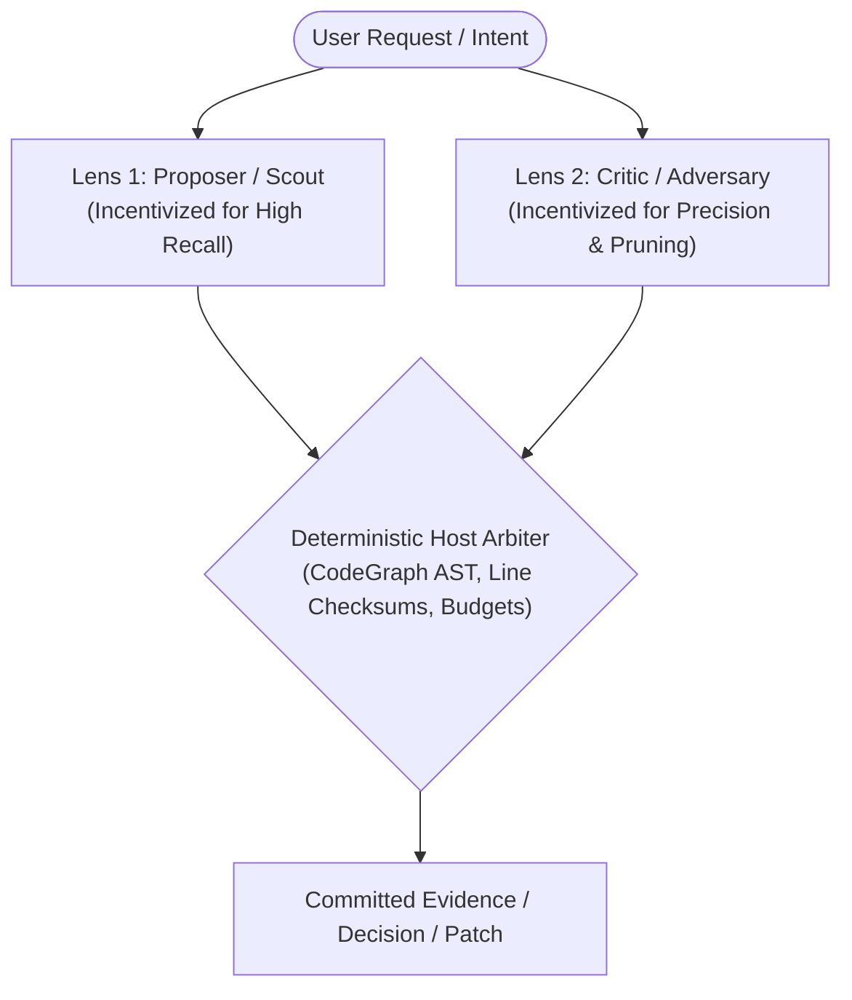
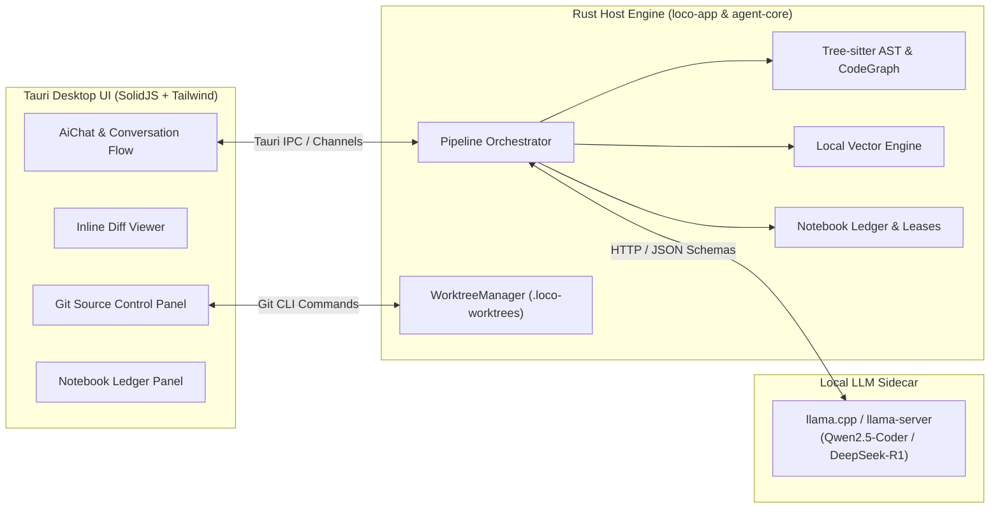

# Loco 🚂

> **High-Performance, Local-First Deterministic Coding Agent & Desktop Studio**

[](https://www.rust-lang.org/)
[](https://tauri.app/)
[](https://www.solidjs.com/)

**Loco** is an autonomous, local-first coding assistant designed to bring frontier-level software engineering performance to local open-weights models (7B–14B) running entirely on your machine.

Instead of relying on fragile, unconstrained single-prompt ReAct loops or expensive cloud APIs, Loco couples a deterministic **Rust host harness** with an embedded **llama.cpp sidecar** and a sleek **SolidJS + Tauri desktop interface**. The local LLM acts strictly as a bounded reasoning coprocessor, while the Rust engine maintains ground truth, AST import topology, token budgets, evidence leases, and sandboxed Git worktrees.

---

## 🌟 Key Innovations

### 1. Stereoscopic Gating Pattern
Local models face severe trade-offs between recall (missing critical context) and precision (hallucinating irrelevant files). Loco breaks through these limits using **Stereoscopic Dialectics** reconciled by the deterministic Rust host:



Loco implements four stereoscopic gates across the pipeline:
- **Gate 1: Stereoscopic Intent Gate (Input Boundary)**: Decomposes multi-intent compound prompts into workspace actions vs. chat/general questions. Directly fulfills non-workspace items without wasting compute.
- **Gate 2: Stereoscopic Evidence Gate (Retrieval Boundary)**: Pairs an Architectural Scout (identifying root entrypoints and callers) with a Precision Pruner (rejecting superficial keyword noise), broken by CodeGraph topology.
- **Gate 3: Appellate Planning Gate (Implementation Boundary)**: Proposer drafts plan &rarr; Critic challenges assumptions &rarr; Rebuttal defends against analysis paralysis &rarr; Reconciler synthesizes &rarr; Host Arbiter verifies leased files.
- **Gate 4: Appellate Stereoscopic Edit Gate (Execution & Patch Boundary)**: Proposer drafts patch &rarr; Critic audits regressions & boundary conditions &rarr; Rebuttal reconciles disputed logic &rarr; Reconciler outputs replacement &rarr; Host Arbiter verifies lease freshness and Tree-sitter syntax validity.

### 2. Multi-Tier Deterministic CodeGraph
- **Tree-sitter AST Symbol Indexing**: Parses Rust, TypeScript, TSX, and JavaScript into structured symbol declarations, line ranges, and cross-file import edges.
- **Short-Circuited Retrieval**: Layered search executing path matches, CodeGraph AST symbol references, BM25 / character n-gram local vector search, and ripgrep regex.
- **Focal Window Slicing**: Extracts precise header context and symbol slices, maximizing signal density within local context limits.

### 3. Interactive Notebook Ledger
- A structured, auditable reasoning scratchpad.
- Every claim, inference, and decision is tagged with **Provenance** and an ephemeral **Evidence Lease ID**.
- **Staleness Cascading**: If an underlying file changes, dependent notebook entries automatically cascade to stale without erasing conversation history.

### 4. Git Worktree Sandboxing
- Edits are formulated in-memory, verified against live leases, and staged in isolated temporary worktrees (`.loco-worktrees/`).
- Dependency caches (`node_modules`) are symlinked for instantaneous validation without disk bloat.
- Orphaned worktrees are automatically cleaned up on startup.

### 5. Developer-Centric Desktop Studio
- **Full-Width Natural Flow**: Vertically stacked conversation stream ensuring markdown explanations, source chips, and diffs read seamlessly top-to-bottom.
- **Inline Diff Viewer**: Interactive `diff2html` syntax-highlighted diffs with line-by-line rendering, copy raw diff, and collapsible views.
- **Right Panel Source Control**: Real-time Git status, branch indicator, untracked file diff previews, and Unified vs. Split view toggles.
- **Telemetry & Tracing**: Live execution status pills with timers, JSONL trace persistence, and optional Arize Phoenix OpenTelemetry export.

---

## 🏛️ Architecture Overview



---

## 📂 Repository Structure

```
loco-app/
├── crates/
│   ├── agent-core/          # Headless, stack-neutral agent engine (Pipeline, Prompts, Patch, Knowledge)
│   └── agent-cli/           # Headless developer CLI (Trace replay, baseline eval, benchmarks)
├── src-tauri/               # Tauri host backend
│   ├── src/
│   │   ├── codegraph.rs     # AST symbol extraction, SQLite graph store, import topology
│   │   ├── engine.rs        # llama-server sidecar lifecycle & health manager
│   │   ├── git_api.rs       # Git status, branch detection, unified diff generator
│   │   ├── indexer.rs       # Incremental workspace watcher and Tree-sitter parser
│   │   ├── orchestrator.rs  # IPC bridge, progress streaming, host adapters
│   │   ├── vector_search.rs # Local sub-token & character n-gram cosine vector search
│   │   └── worktree.rs      # Sandboxed Git worktrees & cache symlinking
│   └── tauri.conf.json      # Tauri application configuration
├── src/                     # SolidJS desktop frontend
│   ├── AIConversation.tsx   # Markdown renderer, code syntax highlighter, source chips
│   ├── AiChat.tsx           # Event stream consumer, execution status pills, prompt input
│   ├── GitPanel.tsx         # Source control panel, diff viewer toolbar, status badges
│   ├── InlineDiffViewer.tsx # Compact inline Git diff component
│   └── NotebookPanel.tsx    # Interactive ledger drawer
├── docs/                    # Architectural specs and progress notes
└── package.json             # Frontend dependencies and build scripts
```

---

## 🚀 Getting Started

### Prerequisites

- **Rust**: `1.80+` ([rustup.rs](https://rustup.rs/))
- **Node.js / Bun**: Bun `1.0+` or Node `20+`
- **Tauri v2 CLI**: `cargo install tauri-cli --version "^2.0.0"`
- **Git**: Installed and available in `$PATH`
- **llama-server binary**: Place your platform's compiled `llama-server` in `src-tauri/binaries/llama-server` (or configure external endpoint).

### Installation & Setup

1. **Clone the repository**:
   ```bash
   git clone git@github.com:ShamanAIFramework/loco-app.git
   cd loco-app
   ```

2. **Install frontend dependencies**:
   ```bash
   bun install
   # or: npm install
   ```

3. **Verify Rust workspace compilation**:
   ```bash
   cargo check --workspace
   cargo check --manifest-path src-tauri/Cargo.toml
   ```

4. **Launch the desktop studio in development mode**:
   ```bash
   bun run tauri dev
   # or: npm run tauri dev
   ```

---

## 🧪 Testing & Verification

Loco maintains strict verification standards across all core crates:

```bash
# Run unit & stereoscopic pipeline tests across headless crates
cargo test --workspace

# Run Tauri host, CodeGraph, and Worktree lifecycle tests
cargo test --manifest-path src-tauri/Cargo.toml

# Build frontend production bundle
bun run build
# or: npm run build
```

### Running the Headless Agent CLI

`agent-cli` enables rapid evaluation, prompt regression testing, and trace inspection without launching the GUI:

```bash
# Inspect and validate an execution trace JSONL
cargo run -p agent-cli -- replay ~/.loco/traces/<run_id>.jsonl

# Run deterministic path-search baseline against a task specification
cargo run -p agent-cli -- baseline path/to/task.json
```
